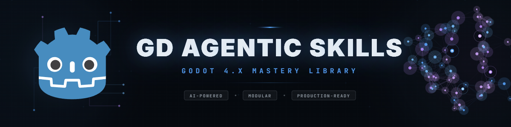

# Godot Game Dev Studio

**Godot Game Dev Studio** is a Codex plugin assembled and curated by **[Powehi](https://powehi.eu)** for Godot 4.7+ game-development work.

It packages a large agentic skill library for Godot architecture, gameplay systems, UI, animation, physics, shaders, optimization, publishing, genre blueprints, and studio-style orchestration roles.

This repository is a curated Codex plugin distribution. It includes and adapts open gamedev skill resources from several projects, including **[Divergent AI / GD Agentic Skills](https://github.com/thedivergentai/gd-agentic-skills)**, **[awesome-gamedev-agent-skills](https://github.com/gamedev-skills/awesome-gamedev-agent-skills)**, **[GodotPrompter](https://github.com/jame581/GodotPrompter)**, **[Claude-Code-Game-Studios](https://github.com/Donchitos/Claude-Code-Game-Studios)**, and **[godot-worldmap-builder](https://github.com/don-tnowe/godot-worldmap-builder)**. See [NOTICE.md](NOTICE.md) for provenance and credits.

<div align="center">
  
</div>

## Credits

- **Plugin assembly, Codex packaging, curation, icon, and distribution**: [Powehi](https://powehi.eu)
- **Original GD Agentic Skills library and many Godot skill resources**: [Divergent AI](https://github.com/thedivergentai)
- **Imported `gamedev-*` skill family**: [gamedev-skills / awesome-gamedev-agent-skills](https://github.com/gamedev-skills/awesome-gamedev-agent-skills)
- **Imported `godot-prompter-*` skill family**: [jame581 / GodotPrompter](https://github.com/jame581/GodotPrompter)
- **Studio orchestration inspiration for `studio-*` skills**: [Donchitos / Claude-Code-Game-Studios](https://github.com/Donchitos/Claude-Code-Game-Studios)
- **Bundled Godot world-map builder sample/addon resources**: [don-tnowe / godot-worldmap-builder](https://github.com/don-tnowe/godot-worldmap-builder), MIT licensed; see `assets/godot-worldmap-builder/LICENSE.md`
- **Godot Engine** is a trademark of its respective maintainers; this project is not affiliated with or endorsed by the Godot Foundation.

## Provenance by folder

| Path prefix | Main provenance |
| --- | --- |
| `skills/godot-*` | Divergent AI / GD Agentic Skills, with Powehi curation and Codex packaging |
| `skills/gamedev-*` | gamedev-skills / awesome-gamedev-agent-skills |
| `skills/godot-prompter-*` | jame581 / GodotPrompter |
| `skills/studio-*` | Powehi Codex adaptation inspired by Donchitos / Claude-Code-Game-Studios |
| `assets/godot-worldmap-builder/` | don-tnowe / godot-worldmap-builder |

## What is included

- `skills/` — Codex skills and reference material for Godot/game-development workflows
- `assets/` — plugin visuals, banners, and selected supporting examples
- `.codex-plugin/plugin.json` — Codex plugin manifest
- `skills_index.json` — machine-readable skill index
- `update_skills_index.py` — helper script for regenerating the index

## Codex plugin installation

This plugin is intended to be installed through a local Codex marketplace entry or from a cloned repository.

For a local personal marketplace workflow:

```powershell
codex plugin add godot-game-dev-studio@personal
```

If your Windows `codex.exe` alias is blocked, the Codex appserver binary may work:

```powershell
C:\Users\x-v-i\.codex\plugins\.plugin-appserver\codex.exe plugin add godot-game-dev-studio@personal
```

After installing or updating the plugin, open a new Codex task/thread so Codex reloads the plugin skills.

## Recommended usage

Use the studio/router skills when the request is broad:

- new game feature planning
- project architecture
- gameplay system design
- code review or modernization
- Godot 4.7 migration
- performance and release readiness

Use individual specialist skills when the request is narrow:

- camera systems
- save/load
- tilemaps
- shaders
- 2D physics
- UI theming
- platform export
- genre-specific mechanics

## Skill index

The full list is available in [skills_index.json](skills_index.json).

Current package highlights:

- Godot 4.7+ guidance
- GDScript patterns
- game architecture
- genre patterns
- publishing workflows
- Godot addon examples
- studio orchestrators

## Development workflow

Validate the plugin manifest and skill metadata before publishing:

```powershell
python C:\Users\x-v-i\.codex\skills\.system\plugin-creator\scripts\validate_plugin.py C:\Users\x-v-i\plugins\godot-game-dev-studio
```

When preparing a local Codex reinstall, update the cachebuster:

```powershell
python C:\Users\x-v-i\.codex\skills\.system\plugin-creator\scripts\update_plugin_cachebuster.py C:\Users\x-v-i\plugins\godot-game-dev-studio
```

Then reinstall:

```powershell
C:\Users\x-v-i\.codex\plugins\.plugin-appserver\codex.exe plugin add godot-game-dev-studio@personal
```

## License

This distribution is released under the **GNU Lesser General Public License v3.0**. See [LICENSE](LICENSE).

Some bundled third-party materials may include their own license notices. See [NOTICE.md](NOTICE.md) and the relevant files under `assets/`.

## Maintainer

Maintained and packaged by **[Powehi](https://powehi.eu)**.
